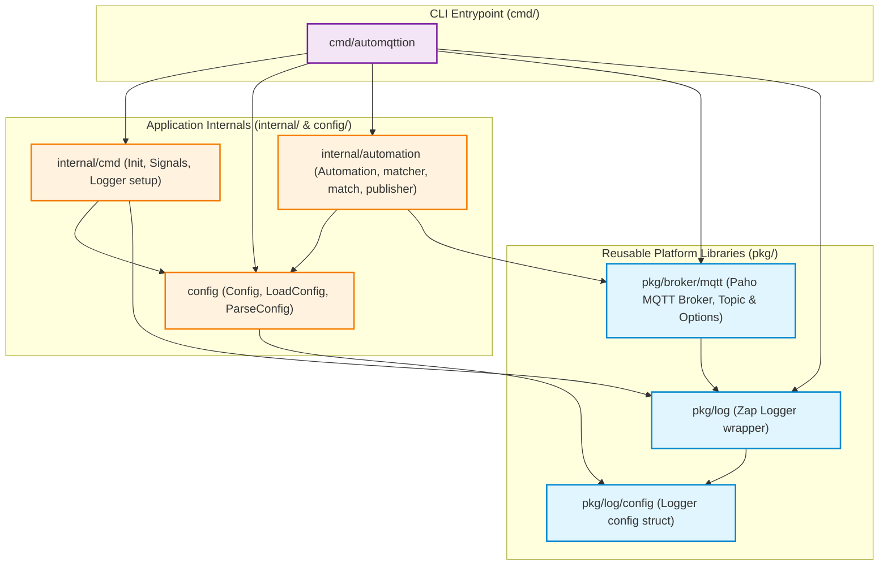
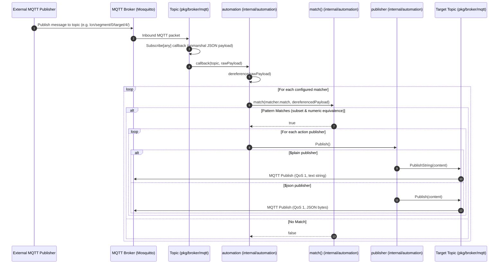
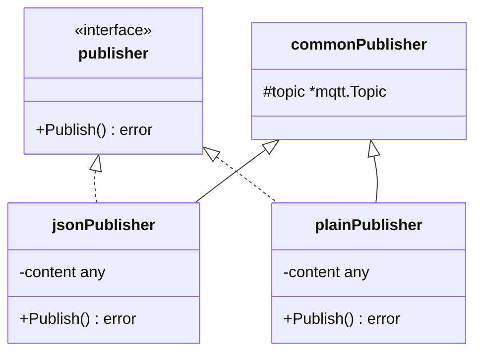

# automqttion System Architecture

This document describes the architectural layout, package dependency graph, reactive message processing pipeline, publisher polymorphism, and container deployment strategy of `automqttion`.

---

## Package DAG & Boundary Decoupling

The repository compiles a single binary from [`cmd/automqttion`](../cmd/automqttion/automqttion.go).
The architecture strictly enforces package boundaries: generic utility packages located under [`pkg/`](../pkg) never import application packages under [`cmd/`](../cmd), [`config/`](../config), or [`internal/`](../internal). This rule is enforced at build and lint time via `.golangci.yml` `depguard` settings.



---

## Reactive Message Processing Sequence

[`cmd/automqttion`](../cmd/automqttion/automqttion.go) acts as an event-driven automation hub. When started, it registers an [`automation`](../internal/automation/automation.go) instance for each topic defined in `cfg.Automate`.

The sequence below illustrates the end-to-end lifecycle when an MQTT message arrives on a monitored topic:



---

## Declarative Pattern Matching Architecture

Pattern matching in [`internal/automation/match.go`](../internal/automation/match.go) is designed for declarative JSON tree inspection:

```
Incoming JSON Data                Target Rule Pattern
{                                {
  "Src": 34,         <=======>     "Src": 34,
  "Cmd": 104,        <=======>     "Cmd": 104,
  "Payload": "MAQ=", <=======>     "Payload": "MAQ="
  "Timestamp": 16999               // Unmatched extra fields ignored
}                                }
```

### 1. Structural Subset Matching
When the target pattern is a `map[string]any`, the matcher iterates across all keys present in the target. It requires each target key to exist in the data map and recursively evaluates [`match(v, dat[k])`](../internal/automation/match.go). Additional fields in the incoming payload are ignored, allowing broad events to trigger targeted automations.

### 2. Cross-Type Numeric Equality
In IoT architectures, numbers often undergo type shifts between producers, brokers, and parsers (e.g., an integer `104` in YAML vs `float64(104)` parsed from JSON).
The function [`numericEqual`](../internal/automation/match.go) avoids false negatives by:
- Verifying both values are numeric (`int`, `uint`, or `float` variants via [`isNumeric`](../internal/automation/match.go)).
- Converting operands bidirectionally via `reflect.Value.Convert`.
- Asserting equality in both directions to prevent loss of precision during narrowing conversions.

### 3. YAML Pre-Compilation (`$yaml`)
During automation initialization in [`NewAutomation`](../internal/automation/automation.go), the helper [`replaceIfYamlMatcher`](../internal/automation/automation.go) scans each rule's match field. If a map contains `$yaml`, the inline string block is unmarshaled into `map[string]any` upfront. Rule evaluation at runtime occurs purely between in-memory Go maps with zero string-parsing overhead.

---

## Action Publisher Polymorphism

Publishers implement the [`publisher`](../internal/automation/publisher.go) interface and dispatch commands to an assigned [`*mqtt.Topic`](../pkg/broker/mqtt/mqttBroker.go):



- **[`plainPublisher`](../internal/automation/publisher.go)**: Selected when configuration contains `$plain`. Formats content with `fmt.Sprintf("%v", content)` and emits an unencoded string (ideal for device commands like `on`, `off`, `toggle`).
- **[`jsonPublisher`](../internal/automation/publisher.go)**: Selected when configuration contains `$json` or as default fallback. Marshals the Go structure into JSON before sending.

---

## Container Build & Kubernetes Deployment Strategy

### Multi-Stage `FROM scratch` Build
The production container is defined in [`build/automqttion/Dockerfile`](../build/automqttion/Dockerfile):

1. **Build Stage (`golang:1.27-alpine`)**:
   - Creates an unprivileged `appuser` (`UID 10001`, `/sbin/nologin`).
   - Downloads modules and copies source code.
   - Compiles a stripped static Go binary using `-ldflags "-w -s -X main.Version=$APP_VERSION -extldflags '-static'"`.
   - Uses build cache mounts (`--mount=type=cache,target=/root/.cache/go-build`) for rapid compilation.
2. **Runtime Stage (`FROM scratch`)**:
   - Zero OS bloat, minimal attack surface, zero shell binaries.
   - Copies CA certificates (`/etc/ssl/certs/ca-certificates.crt`), timezone database (`/usr/share/zoneinfo`), and `/etc/passwd` + `/etc/group` from builder.
   - Copies the statically compiled binary `/dist/automqttion` and default configuration `/config/config.yml`.
   - Runs as unprivileged `USER appuser:appuser` with entrypoint `["/automqttion"]`.

### Kubernetes Helm Chart
The repository includes a production-ready Helm chart under [`helm/charts/automqttion`](../helm/charts/automqttion):
- [`Chart.yaml`](../helm/charts/automqttion/Chart.yaml): Versioned application chart (`version: 0.0.6`, `appVersion: "0.0.6"`).
- [`values.yaml`](../helm/charts/automqttion/values.yaml): Default values specifying image repository `ghcr.io/mychaos87/automqttion`, resource limits, pod security contexts, and replicas.
- [`templates/deployment.yaml`](../helm/charts/automqttion/templates/deployment.yaml): Standard Kubernetes Deployment manifest with readiness and liveness lifecycle definitions.
- [`templates/serviceaccount.yaml`](../helm/charts/automqttion/templates/serviceaccount.yaml): Dedicated ServiceAccount for RBAC isolation.
- [`templates/hpa.yaml`](../helm/charts/automqttion/templates/hpa.yaml): Optional HorizontalPodAutoscaler for high-throughput MQTT workloads.
